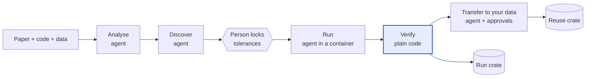

# reCRATE

**Check the paper. Use the method. Keep the record.**

reCRATE turns a scientific paper into an [RO-Crate](https://www.researchobject.org/ro-crate/), checks each of the paper's claims against what its code and data actually produce, applies the method to your own data behind approval gates, and records every run as an RO-Crate that anyone can re-check.

AI agents do the messy parts: reading the paper, finding the code, repairing old environments, mapping your data. **Plain, deterministic code decides every verdict.** No agent can mark its own work as passed, and the agent that runs the code is never shown the numbers it is supposed to produce.

> Status: hackathon prototype. The verifier, crate format, gates and tests work today on one real paper. The agents are designed but not built yet. See [what works now](#what-works-now).

## How it works



Each claim in the paper gets one verdict:

| Verdict | Meaning |
| --- | --- |
| Independently checked | Re-executed, matches, and a check that doesn't use the authors' code agrees |
| Reproduced | Re-executed here; matches within a tolerance a person locked before the run |
| Reproduced only after changes to analysis code | Matches, but the agent had to edit the authors' analysis |
| Matches recorded outputs | The paper agrees with output files the authors shipped; not re-executed |
| Near / Does not match | Outside tolerance (within twice it / beyond) |
| Could not run / Not run | Blocked (reason recorded) / no run in the environment the claim needs |

Reproducing a result is not the same as the method being valid; reCRATE says which one it has shown.

## Quick start

```bash
git clone https://github.com/punekichikki/reCRATE.git
cd reCRATE
python -m venv .venv && source .venv/bin/activate
pip install -e ".[dev]"

python -m unittest discover -s tests -t .        # 37 tests, including planted errors

recrate check  examples/peikert2021/paper-crate
recrate verify examples/peikert2021/paper-crate \
  --observed examples/peikert2021/work/observed-shipped-3.5.0.json examples/peikert2021/work/observed-shipped-3.6.1.json \
  --independent examples/peikert2021/work/independent-I1.json \
  --out /tmp/run-01 --unlocked
recrate report /tmp/run-01

recrate site                                     # results page for every crate in examples/
open site/index.html                             # macOS; any browser works, no server needed
```

## Results page

`recrate site` builds a static page from real paper crates and run crates: each claim with what the paper says, what was observed, the tolerance and the verdict, plus independent checks, gaps, what ran and the files with their checksums. The page only displays verdicts; it never computes them. You can also open any paper crate and run crate in it with **Open crate files**.

To publish it on GitHub Pages: in the repository settings, set **Pages → Source** to **GitHub Actions**, then run the **pages** workflow from the Actions tab.

[`ui/mockup.html`](ui/mockup.html) is the earlier pitch mockup with a fictional paper and simulated runs, including the reuse flow that isn't built yet.

## Example: Peikert & Brandmaier (2021)

[`examples/peikert2021/`](examples/peikert2021/) takes a paper about reproducible R workflows through the pipeline. The paper shows seeded R code giving different numbers in R 3.5.0 and R 3.6.1.

- **All 5 claims match the authors' recorded outputs.** Re-execution in real R 3.5.0 and 3.6.1 is the next step (commands in the example's README, locally or on Hugging Face Jobs).
- **An independent check found the headline conclusion fragile.** A separate Python re-implementation of the bootstrap excludes zero in 46% of 200 seeds; the authors' own files show 7 of 10 seeds in R 3.5.0 and 3 of 10 in R 3.6.1. The numbers do change with the R version, as the paper says, but the yes/no conclusion depends on the seed in both versions.
- **5 gaps recorded**, including a Dockerfile that installs from Microsoft MRAN, which was retired in 2023.

## What works now

| Part | Status |
| --- | --- |
| Verifier: comparators (`exact`, `rounded`, `abs`, `rel`, `distribution`, `derived`), patch downgrades, independent-check upgrades | Working, tested |
| Gates: tolerance lock, integrity and checksum checks, patch and change classification, approvals | Working, tested |
| Paper crate and run crate (RO-Crate 1.2 + Process Run Crate 0.5) | Working, checked in CI |
| Image metric (object F1 over IoU thresholds) | Working, tested; image loading still to build |
| Runners: local Docker, Hugging Face Jobs (with a per-run budget guard) | Thin wrappers, untested |
| Agents: analysis, discovery, execution, adaptation | Designed ([`agents/`](agents/)), not built |
| Results page (`recrate site`, [`ui/index.html`](ui/index.html)) | Working on real crates, tested |
| Transfer to your own data | Rules and gates done; stage not built ([`ui/mockup.html`](ui/mockup.html) shows the intended flow) |

The full design, team split and timeline are in [`docs/IMPLEMENTATION_PLAN.md`](docs/IMPLEMENTATION_PLAN.md).

## Repository layout

```
recrate/          Python package: cli, orchestrator, core (verify, crate, classify), plugins, runners, site
schemas/          JSON Schemas: the contracts between stages
agents/           one PROMPT.md per agent, and who may read and write what
examples/         papers taken through the pipeline (crates, observed values, run crates)
tests/            golden results, planted errors, schemas, image metric, site builder
docs/             implementation plan
ui/               results page (index.html) and pitch mockup (mockup.html)
CLAUDE.md         shared rules for every Claude session working on this repo
```

## Running on Hugging Face Jobs

Runs can execute on [Hugging Face Jobs](https://huggingface.co/docs/hub/jobs-pricing): any Docker image, CPU or GPU, billed per minute from your credits. Install with `pip install -e ".[hf]"`, copy `.env.example` to `.env` and set `HF_TOKEN`. `RECRATE_MAX_USD_PER_RUN` caps the worst-case cost of a single run. Never commit `.env`.

## Built on

- [RO-Crate 1.2](https://w3id.org/ro/crate/1.2) and the [Workflow Run Crate](https://www.researchobject.org/workflow-run-crate/) profiles
- Ideas from [Paper2Agent](https://arxiv.org/abs/2509.06917) (papers as agents) and [CORE-Bench](https://arxiv.org/abs/2409.11363) (computational reproducibility benchmarks)

## Licence

Code and documentation: MIT ([`LICENSE`](LICENSE)). Files copied from other projects keep their licence; see [`THIRD_PARTY.md`](THIRD_PARTY.md).
