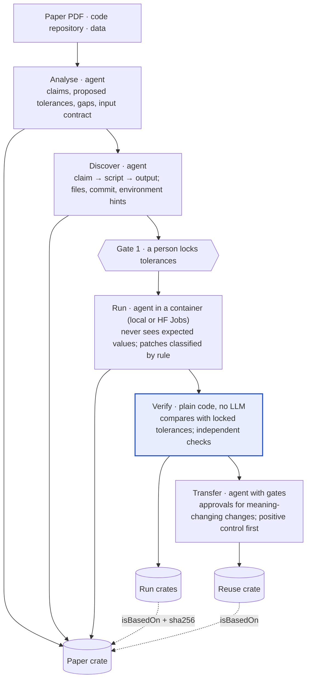
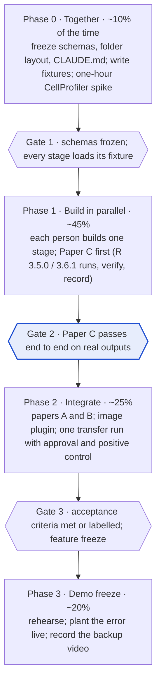

# reCRATE: Technical Implementation Plan

Status: draft · Last updated 2026-10-17

## Overview

reCRATE turns a scientific paper into an RO-Crate, checks each of the paper's claims at three levels of assurance, applies the method to a user's own data behind approval gates, and records every run as an RO-Crate. The hackathon target is one command-line tool that runs end to end on three real papers, plus a demo page that reads its real outputs.

**The problem (from the hackathon brief).** Turning a paper into a runnable workflow takes days of manual setup. Code that runs is not the same as results that reproduce, and neither proves the method is valid. Applying a method to new data can silently change its meaning. Every run must be traceable.

**Design principle.** AI agents handle the messy parts: reading the paper, finding resources, repairing environments, mapping data, explaining differences. Plain, deterministic code decides every verdict. No agent can mark its own work as passed.

**In scope for the hackathon**

- A `recrate` command-line tool with six stages: analyse, discover, lock, run, verify, transfer.
- Two crate formats: the paper crate and the run crate, built on RO-Crate 1.2, the Process Run Crate 0.5 profile and a small draft extension (the `rc:` terms).
- Two data plugins: tabular and image.
- Three demo papers covering three situations: full materials, data only, and packaged-but-aged.
- Two execution backends: local Docker and Hugging Face Jobs (CPU and GPU, paid from credits).
- A results page that renders verdicts from the real run crates (`recrate site`).

**Not in scope**

- GPU work longer than a few hours (for example DeepCell's 25-hour training). These claims are recorded as "could not run" with the reason.
- Comparing figures pixel by pixel. We compare the numbers behind figures.
- Judging whether a method is scientifically sound. We report reproducibility and independent checks, and say clearly that these are different from validity.
- A hosted multi-user service.

## Implementation status

| Part | Status | Where |
| --- | --- | --- |
| Claim, observed, patch, change, gap, independent-check schemas | Done | `schemas/` |
| Deterministic verifier, all comparators, derived claims, patch downgrades, independent-check upgrades | Done, tested | `recrate/core/verify.py`, `recrate/plugins/tabular.py` |
| Tolerance lock (gate 1), integrity and checksum checks | Done, tested | `recrate/core/verify.py`, `recrate/core/crate.py` |
| Patch and change classification (gates 2 and 3 rules) | Done, tested | `recrate/core/classify.py`, `recrate/orchestrator.py` |
| Run-crate writer (Process Run Crate 0.5) | Done, tested | `recrate/core/crate.py`, `recrate/core/verify.py` |
| Image metric (object F1 over IoU thresholds) | Done, tested | `recrate/plugins/image.py` |
| Paper C crate, first run crate, independent check | Done | `examples/peikert2021/` |
| Local and Hugging Face Jobs runners | Thin wrappers, untested | `recrate/runners/` |
| Analysis, Discovery, Execution, Adaptation agents | Briefs written, not built | `agents/` |
| Image loading, profiling, independent checks | Not built | `recrate/plugins/image.py` TODOs |
| Results page on real crates (`recrate site`) | Done, tested | `ui/index.html`, `recrate/site.py` |
| Pitch mockup of the full flow, including reuse | Simulated data | `ui/mockup.html` |

## System architecture

Five stages run in order, and the only interface between them is a set of RO-Crate files on disk. Four stages are agents; the verify stage, where verdicts are decided, is plain code.



Any stage can be re-run alone from the files on disk, which is also how four people can build in parallel: each stage reads and writes agreed files, never another stage's code.

## Data model

Two RO-Crates carry everything: one **paper crate** per paper, and one **run crate** per verification or reuse run. A working example is in `examples/peikert2021/`.

**Paper crate** (written by Analyse, Discover and Run; read by every later stage)

| Entity | RO-Crate type | Written by | Holds |
| --- | --- | --- | --- |
| Root dataset | `Dataset` | Analyse | Name, description, licence, `isBasedOn` the paper and repo, `conformsTo` the reCRATE profile |
| Paper | `ScholarlyArticle` | Analyse | DOI, title, authors (ORCID), date |
| Code | `SoftwareSourceCode` | Discover | Repository URL and exact commit |
| Files | `File` | Discover | Path, sha256, size, format, origin (authors or tool), licence |
| Claims | `Claim` | Analyse | One per checkable result (`schemas/claim.schema.json`) |
| Gaps | `rc:Gap` | Analyse, Discover | What is missing, ambiguous or inconsistent, with evidence |
| Environments | `SoftwareApplication`, `ContainerImage` | Discover, Run | Language versions, base image, RNG settings |
| Input contract | `rc:InputContract` | Analyse | What new data must look like for reuse |

Next to the metadata, `claims.lock.json` holds the sha256 of the claims as a person confirmed them (gate 1).

**Run crate** (written by Verify and Transfer; follows Process Run Crate 0.5)

| Entity | RO-Crate type | Holds |
| --- | --- | --- |
| Root dataset | `Dataset` | `isBasedOn` the paper crate (with the sha256 of its metadata), claims hash, lock status |
| Each execution | `CreateAction` | Environment, runner, result file, status, error if it could not run |
| Each patch | `UpdateAction` | File, diff, class (environment or analysis), reason |
| Each verdict | `PropertyValue` | Claim, expected, observed, tolerance, verdict, evidence, detail |
| Each independent check | `CreateAction` with `additionalType rc:IndependentCheck` | Method, outcome, summary |
| Observed outputs | `File` | The JSON of observed values per run, with sha256 |

**Claim fields**

```json
{
  "@id": "#claim-C3", "@type": "Claim", "identifier": "C3",
  "name": "Bootstrap 95% BCa CI for the slope is 0.0097 to 0.3842 under R 3.5.0",
  "rc:claimLocation": "manuscript.Rmd l.220-227",
  "rc:dataType": "tabular",
  "rc:expectedValue": [0.0097, 0.3842],
  "rc:comparison": "rounded", "rc:decimalPlaces": 4,
  "rc:tolerance": "equal after rounding to 4 decimals (as reported)",
  "rc:toleranceSetBy": "proposed by agent; confirmed by <name> at <time>",
  "rc:requiresEnvironment": {"r_version": "3.5.0"},
  "rc:outputKey": ["boot_ci_lower", "boot_ci_upper"],
  "rc:producedBy": "R/bootstrap.R"
}
```

A derived claim replaces `rc:outputKey` with a condition over other claims:

```json
"rc:comparison": "derived",
"rc:condition": [{"claim": "C3", "index": 0, "op": ">", "value": 0},
                 {"claim": "C4", "index": 0, "op": "<=", "value": 0}]
```

**Draft profile terms.** Everything not prefixed `rc:` is standard RO-Crate 1.2, Schema.org or Workflow Run Crate. The `rc:` terms live under a placeholder namespace until we name the profile.

| Term | Used on | Meaning |
| --- | --- | --- |
| `rc:claimLocation` | Claim | Table, figure, page or manuscript line |
| `rc:dataType` | Claim | Which plugin compares it: tabular, image, simulation |
| `rc:expectedValue`, `rc:comparison`, `rc:tolerance`, `rc:toleranceValue`, `rc:decimalPlaces`, `rc:interval` | Claim | What "matches" means, fixed before running |
| `rc:toleranceSetBy` | Claim | Who proposed and who confirmed the tolerance |
| `rc:requiresEnvironment` | Claim | Environment the claim was produced in, if it matters |
| `rc:outputKey`, `rc:producedBy`, `rc:condition` | Claim | Which output and script produce it; how a derived claim is computed |
| `rc:Gap`, `rc:severity`, `rc:evidence` | Gap | A missing or inconsistent detail and where it was found |
| `rc:InputContract`, `rc:requiredColumns`, `rc:columnTypes`, `rc:validatedRange` | Contract | Rules new data must meet for reuse |
| `rc:observedValue`, `rc:evidence`, `rc:detail`, `rc:independentCheck` | Verdict | What was seen and what supports the verdict |
| `rc:outcome`, `rc:summary` | Independent check | Robust, fragile or contradicted, in one sentence |
| `rc:claimsSha256`, `rc:claimsLocked`, `rc:claimsLockedBy` | Run crate root | Which claims were judged, and whether a person locked them |

## Agents and permissions

Five agents do the judgement-heavy work, and each is boxed in by what it may read and write. Each agent is a separate Claude session with its own instructions (`agents/*/PROMPT.md`) and an allowlist of tools, started by the Python orchestrator. Verdicts are never produced by an agent.

| Agent | Reads | Writes | May not |
| --- | --- | --- | --- |
| Paper Analysis | Paper PDF, supplementary text | Claims (with proposed tolerances), method summary, gaps, input contract | Run code; set final tolerances |
| Resource Discovery | Paper, repository, data links | Resource map (claim → script → output file), environment hints, file entities, inconsistency gaps | Edit any code or data |
| Reconstruction & Execution | Repository, resource map, environment | Container, run script, observed outputs, patch proposals | **See expected values**; edit claims or tolerances |
| Verification (explainer) | Claims, observed outputs, verdicts | Explanations of mismatches, choice of independent checks | Edit code, data or verdicts |
| Data Adaptation | Input contract, user data | Compatibility report, change proposals, positive-control request | Apply a meaning-changing change without approval |

**The execution agent never sees the paper's numbers.** It knows which outputs to produce, but not what values they should have (`orchestrator.withhold_expected_values`). This removes the temptation to bend code until the numbers match, which is the main way an agent could fake a reproduction.

**Validation gates** (enforced in code, not by prompts)

1. **Tolerance lock.** `recrate lock` records the sha256 of the confirmed claims. `recrate verify` refuses unlocked or changed claims unless `--unlocked` is passed, and the run crate records which it was.
2. **Patch classification.** `core/classify.py` decides: changes only to environment files (Dockerfile, lockfiles, requirements) are *environment*; anything else, and any script named in a claim's `rc:producedBy`, is *analysis*. An analysis patch downgrades the claims that script produces to "reproduced only after changes to analysis code".
3. **Approval for meaning-changing adaptations.** `orchestrator.gate_approvals` pauses and asks a person, or reads `approvals.json`. The decision, the person and the reason are recorded.
4. **Positive control.** Before user results are released, the paper's own data must still reproduce in the same environment and run (`orchestrator.gate_positive_control`).

## Verification engine

The verifier is plain Python with no LLM inside: it compares observed values with locked claims and assigns one verdict per claim (`recrate/core/verify.py`).

**Verdicts, strongest first**

| Verdict (`value` in the run crate) | Meaning |
| --- | --- |
| `independently-checked` | Reproduced, and an independent check that does not use the authors' code agrees (outcome robust) |
| `reproduced` | Re-executed here; matches within the locked tolerance |
| `reproduced-after-analysis-changes` | Matches, but only after a patch to the script that produces it |
| `matches-recorded-outputs` | The paper agrees with output files the authors shipped; not re-executed |
| `near` | Outside tolerance but within twice the tolerance |
| `mismatch` | Re-executed; outside tolerance |
| `inconsistent-with-recorded-outputs` | The paper disagrees with the authors' own shipped outputs |
| `could-not-run` | Blocked by compute, missing data or an unrepairable environment; reason recorded |
| `not-run` | No run in the environment the claim requires |

An independent check can return **fragile** (holds for some seeds or settings, not others) or **contradicted**. These sit beside the verdict rather than replacing it.

**Comparators** (chosen per claim by `rc:comparison`)

| Comparator | Passes when | Typical use |
| --- | --- | --- |
| `exact` | Values identical | Counts, sample sizes, seeded draws |
| `rounded` | Observed lies inside the rounding interval of the reported value | Any number reported to fixed decimals |
| `abs`, `rel` | Within a fixed or relative tolerance (`rc:toleranceValue`) | Results with known numerical noise |
| `distribution` | Reported value lies inside the central 95% of N seeded runs | Random splits, bootstraps, stochastic training |
| `derived` | A condition over other claims holds | Conclusions such as "CI excludes zero" |

**Tolerance policy**

- The analysis agent proposes a tolerance from the reported precision. A value reported to 3 decimals gets `rounded` with 3 decimals.
- If the method involves randomness and the seed is not reported, the claim uses `distribution`, and the missing seed becomes a gap.
- A person confirms all tolerances in one go (`recrate lock`). After that they are locked.

**Derived claims are only as strong as their inputs.** A conclusion built from two claims counts as re-executed only if both inputs were.

**Independent checks** come from the data plugin for the claim's type: re-derive a number from raw data; re-implement the statistic with a different library; sanity rules (ranges, totals, units, pixel sizes); for simulations, conservation laws and limiting cases.

**Testing the verifier itself.** `tests/test_verify.py` plants errors and requires the verifier to catch every one: a changed expected value, a perturbed output, an analysis patch, a wrong environment, a run that could not happen, a claim edited after locking, a tampered data file, a missing file.

## Transfer to user data

Transfer runs only after the paper has been verified, and it changes nothing silently: every difference between the user's data and the input contract becomes a logged change, and meaning-changing ones wait for a person.

**Steps**

1. Load the paper crate's input contract and the user's data.
2. The plugin profiles the data: format, columns or channels, units, pixel size, ranges, missing values.
3. The adaptation agent compares profile and contract and writes a compatibility report.
4. For each difference it proposes a change; `classify_change` sets the class.
5. Routine changes are applied and logged. Meaning-changing changes pause for approval.
6. **Positive control:** re-run a sample of the paper's own data in the same environment. If it no longer reproduces, stop.
7. Run the workflow on the user's data with the paper's parameters, unless an approved change says otherwise.
8. Re-validate: run the plugin's sanity checks on the new outputs and flag rows outside the validated range.
9. Write the reuse crate: changes, approvals, control result, outputs, warnings, and `isBasedOn` the paper crate.

**Change classes** (`CHANGE_RULES` in `recrate/core/classify.py`; unknown kinds count as meaning-changing)

| Difference | Class | Action |
| --- | --- | --- |
| File format, units, pixel size, column names, IDs, types | Routine | Convert or map, log the method and factor |
| Brightness or exposure | Routine | Normalise, log the method |
| Values outside the tested range | Warning | Keep, flag in the record and the report |
| Missing values (drop or impute) | Meaning-changing | Pause for approval |
| Changed parameter, threshold, model or preprocessing | Meaning-changing | Pause for approval |

## Data-type plugins

Everything that depends on the kind of data lives in a plugin, so the agents and the core stay the same for every paper.

```python
class DataPlugin:
    name: str                                   # "tabular", "image", "simulation"
    def can_handle(self, path) -> bool
    def load(self, path) -> object
    def profile(self, data) -> dict             # columns, units, ranges, pixel size
    def extract(self, data, output_key) -> Any  # pull the value a claim points at
    def compare(self, observed, claim) -> Comparison
    def independent_checks(self, claim, data) -> list[CheckResult]
    def check_compatibility(self, profile, contract) -> list[Change]
```

- **Tabular** (all three papers; done): comparators, CSV profiling, compatibility checks. Standard library only.
- **Image** (Paper A; partly done): object F1 over IoU thresholds 0.50 to 0.90 and object counts are implemented and tested. Still to build: TIFF/PNG loading, mask decoding, Otsu re-segmentation check, pixel-size check.
- **Adding a plugin** (for example, simulation): one file implementing the interface, an entry in `recrate/plugins/__init__.py`, and a test with a small golden example.

## Execution and environments

Every run happens inside a container, and every change the agent makes to get there is written to the patch ledger before it takes effect.

**What the paper shares decides the path**

| Paper provides | Path | Best possible verdict |
| --- | --- | --- |
| Code and data | Rebuild environment, run authors' code | Independently checked |
| Code and recorded outputs | Compare paper with shipped outputs first, then re-execute | Reproduced |
| Data, no code | Agent writes the analysis from the Methods text; the script is marked as tool-written | Reproduced (of a reconstruction), plus independent checks |
| Code, no data | Run on sample or synthetic data; check code matches the Methods | Executed only |
| Neither | Analysis only | Gaps report |

**Runners** (`recrate/runners/`)

| Runner | Use | Notes |
| --- | --- | --- |
| `local` | Development, offline work | Needs a Docker daemon |
| `hf-jobs` | Demo runs, GPU, many seeded runs in parallel | Any Docker image, billed per minute from Hugging Face credits. Default timeout 30 minutes; set it for long runs. A per-run budget guard (`RECRATE_MAX_USD_PER_RUN`) refuses runs whose worst-case cost is higher |

A Job cannot see local files: its command fetches the crate (from this GitHub repo or a Hugging Face dataset repo) and returns observed JSON through its logs or an upload. The run crate records the Job ID, hardware and image digest, since GPU results can differ by hardware.

Approximate prices (see the Jobs pricing page): `cpu-basic` $0.01/hour, `t4-small` $0.40/hour, `a10g-small` $1.00/hour. Paper A's U-Net training (about 1 GPU hour in the paper) costs roughly one to two dollars.

**Environment build order**

1. Use the authors' own recipe if one exists (Dockerfile, environment.yml, renv.lock, requirements.txt).
2. If it fails, repair the smallest thing: a dead package repository, a moved download, a missing system library. Prefer dated snapshots so versions stay as the authors had them (for example, CRAN from a dated Posit Package Manager snapshot instead of the retired Microsoft MRAN).
3. If no recipe exists, infer versions from the paper, file dates and imports, and pin them.
4. Record the image digest, language versions, package list and RNG settings.

**Randomness.** Seeds and RNG settings are captured for every execution. Claims from stochastic methods with unreported seeds use the `distribution` comparator, with the seeded runs spread across parallel Jobs.

## Repository, stack and CLI

```
recrate/
  CLAUDE.md                  shared rules for every Claude session
  docs/IMPLEMENTATION_PLAN.md
  schemas/                   contracts between stages (JSON Schema)
  agents/                    one PROMPT.md per agent, plus a README with permissions
  recrate/
    cli.py                   `recrate` command
    orchestrator.py          stage order and gates                     (Person 3)
    core/verify.py           deterministic verifier                    (Person 3)
    core/crate.py            read, check and write RO-Crates           (Person 3)
    core/classify.py         patch and change classification           (Person 3)
    plugins/tabular.py       comparators, tabular profile              (Person 3)
    plugins/image.py         image metric, loaders (TODO)              (Person 4)
    runners/local.py         Docker on this machine                    (Person 2)
    runners/hf_jobs.py       Hugging Face Jobs                         (Person 2)
    site.py                  builds the results page                   (Person 4)
  examples/peikert2021/      Paper C: crate, observed values, run crate, scripts
  tests/                     golden results, planted errors, schemas, metric
  ui/index.html              results page template; ui/mockup.html pitch mockup (Person 4)
  papers/<paper-id>/         local working folders (git-ignored)
```

**Stack:** Python 3.10+; numpy; Claude for agents (one session per agent, tool allowlists); Docker and Hugging Face Jobs; jsonschema, scipy and pytest for development; tifffile and scikit-image for images; RO-Crate JSON-LD written directly, with `rocrate-validator` in CI.

**CLI**

```bash
recrate check    <crate>                                  # structure + checksums          (works)
recrate lock     <paper-crate> --by "Name"                # gate 1                         (works)
recrate verify   <paper-crate> --observed obs*.json \
               [--independent i*.json] [--patches patches.json] --out <run-crate>   (works)
recrate report   <run-crate>                              # print verdicts                 (works)
recrate site     [--roots examples] [--out site]          # results page                   (works)
recrate analyse | discover | run | transfer | all <paper-dir>   # agents and full pipeline  (to build)
```

## Demo papers and test plan

Three papers from three fields cover the three situations the brief cares about, and the same CLI must run all three with no code changes.

| Paper | Field, data | Shares | Claims to check | Expected outcome | Demo moment |
| --- | --- | --- | --- | --- | --- |
| A. [Caicedo et al. 2019](https://pmc.ncbi.nlm.nih.gov/articles/PMC6771982), nucleus segmentation | Cell biology; 200 TIFF images + masks ([BBBC039](https://bbbc.broadinstitute.org/BBBC039), 78 MB, CC0) | Code + data | CellProfiler F1 0.790 and 0.811; test-set nucleus count; U-Net F1 0.898 | CellProfiler reproduced on CPU; counts independently checked; U-Net run on an HF Jobs GPU if its 2019 Keras/TensorFlow stack can be revived | Repo has one CellProfiler pipeline but the paper reports two; old CellProfiler 3.0 needs repair |
| B. [Gorman et al. 2014](https://www.ncbi.nlm.nih.gov/pmc/articles/PMC3943793/), penguin dimorphism | Ecology; 344 birds, tabular | Data only | Sample sizes 152/68/124; size-dimorphism index −0.20; isotope intercepts; sex-prediction accuracy 88.64% | Counts and models reproduced from a reconstructed workflow; accuracy checked by `distribution` (split seed not reported) | Agent rebuilds the analysis from the Methods text and finds the dimorphism formula in a cited paper |
| C. [Peikert & Brandmaier 2021](https://qcmb.psychopen.eu/index.php/qcmb/article/view/3763), reproducible R workflow | Psychology methods; simulated tabular | Code + data + Docker | Seeded draws and bootstrap CIs in R 3.5.0 vs 3.6.1; conclusion flips | All five match the shipped outputs (done); re-execution in both R versions next; independent check: fragile (46% of 200 seeds) | Dockerfile depends on retired MRAN; conclusion depends on the seed in both versions |

**Acceptance criteria**

- [ ] `recrate all` completes on papers A, B and C with no code changes between them
- [ ] Every claim ends with one verdict from the verdict table; none blank
- [ ] At least one claim reaches "independently checked" per paper
- [ ] Paper A records the CellProfiler pipeline mismatch as a gap; U-Net either reproduced on GPU or "could not run" with a reason
- [ ] Paper B's workflow script is marked as tool-written in the paper crate
- [ ] Paper C re-executed in R 3.5.0 and 3.6.1; C1–C5 upgrade to "reproduced"
- [ ] One transfer run with one routine change and one approved meaning-changing change, plus a passing positive control
- [ ] All crates pass `recrate check`, and `rocrate-validator` where it installs
- [x] Planted-error suite: every planted error is caught (`tests/test_verify.py`)
- [ ] Results page renders all three papers from their run crates (works for Paper C)

**Tests** (`python -m unittest discover -s tests -t .`, also run in CI)

| Test file | What it proves |
| --- | --- |
| `test_comparators.py` | Each comparator passes and fails at the right boundaries |
| `test_verify.py` | Golden verdicts for Paper C; every planted error caught; lock, integrity and checksum gates |
| `test_classify_image_schemas.py` | Patch and change rules; approval recording; expected values withheld; image metric; schemas |
| `test_site.py` | Results page builds from real crates; refuses tampered crates; data safely embedded |

## Team split and timeline

Each person owns one stage end to end, with Claude Code working in their folder and `CLAUDE.md` holding the shared rules. Paper C goes through the whole pipeline first, because it is small and already has a working crate.

| Person | Owns | Delivers | Demo moment |
| --- | --- | --- | --- |
| 1 | Paper Analysis agent | `recrate analyse` and the tolerance review; claims, gaps and input contracts for papers A, B and C | Claims with page and table references, plus the gaps list |
| 2 | Discovery and Execution agents, runners | Resource maps, containers for R, Python and CellProfiler, environment repair, patch ledger, HF Jobs runs | A broken build repaired live and logged as environment-only |
| 3 | Core | Orchestrator and gates, verifier, crates, classifier, tabular plugin, schemas, tests | The verdict table, and a planted error turning red |
| 4 | Transfer, image plugin, UI, pitch | Adaptation agent, approvals, positive control, image plugin, demo page, demo script, backup video | The pipeline pausing for approval, and a reuse record linking back to the paper |



Phase shares are fractions of the total time until we know the hackathon length. Gate 2 is the one to protect: if Paper C does not pass end to end, papers A and B wait.

## Risks and open questions

The biggest risk is environment setup on stage, so every demo run must also exist as a recorded run crate and a backup video.

| Risk | Effect | Mitigation |
| --- | --- | --- |
| CellProfiler 3.0 will not run headless | Paper A loses its main reproduced claims | One-hour spike first; fall back to evaluation code + independent mask checks, and show "could not run: environment" with the diagnosis |
| U-Net's 2019 Keras/TensorFlow stack will not run on current GPU images | No GPU result for Paper A | Time-boxed spike on HF Jobs; otherwise "could not run" with the reason |
| Agent bends code toward the paper's numbers | A fake "reproduced" | Execution agent never sees expected values; analysis patches are classified by rule and downgrade verdicts |
| A stuck agent loop spends Hugging Face credits | Budget gone before the demo | Per-run budget guard; explicit Job timeouts; cancel stuck Jobs |
| Live run hangs or downloads fail during the demo | Dead air on stage | Pre-built images, cached data, recorded run crates, backup video |
| Reconstruction for Paper B guesses wrong | Mismatches that are our fault, not the paper's | Script marked tool-written; gaps list every guess |
| Tolerances set loosely to make claims pass | Weak verdicts that look strong | Tolerance shown beside every verdict; lock hash breaks if claims change |
| Scope too large for the time | Nothing works end to end | Build order: Paper C end to end first; image plugin and transfer after |

**Open questions**

- [ ] How long is the hackathon? The timeline uses fractions until we know.
- [ ] Product name and profile namespace for the `rc:` terms.
- [ ] Which Claude access and budget do we have for agent runs?
- [ ] How do Jobs fetch inputs and return outputs: this GitHub repo, or a Hugging Face dataset repo?
- [ ] Which second nuclei dataset do we use for Paper A's transfer demo?
- [ ] Palmer penguins data licence before committing a copy.
